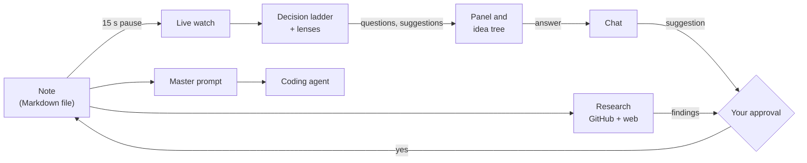

<p align="center"></p>

# Concept Trail — Introduction

**English** · [Türkçe](TANITIM.md)

> **A notebook that helps you think an idea through before you write code.**
> You write; the assistant asks about the idea's open ends, talks your answers through with you, researches who has built it before, and finally writes a complete brief that an AI coding agent can build from without asking a single question. It never writes a word into your note without your approval.

---

## The problem it solves

When a software idea first comes to mind it is still blurry — and that is exactly when we start coding. Along the way we run into questions we never thought about, and some are so basic that the project has to be rebuilt.

**A familiar example:** "I keep forgetting to water my plants, I'll make an app that reminds me." You build a one-person to-do list. Two weeks later your partner wants to use it too. Now every plant needs an *owner*, the reminder has to reach the right person, two phones have to see the same data. Your data model, your notification logic and your storage knew none of this; you rewrite half of it.

Yet the question could have been asked on day one: *"Will only you use this, or everyone at home?"* Concept Trail asks those questions in the right order, at the right time.

| Problem | What usually happens | In Concept Trail |
|---|---|---|
| **Starting from a blurry idea** | A basic decision (who uses it, where it runs) changes late and the system is rebuilt | The **decision ladder** asks about scope first, then architecture, then components, details last |
| **Not knowing what you don't know** | The question nobody asked comes back as a bug | Each round, the eyes of an **Architect, Product, Security & Operations** and **Developer** critique the note; edge cases and failure modes are asked on their own rung |
| **Reinventing the wheel** | Weeks later you find a mature project that does the same | **Research** finds similar projects on GitHub and the web, compares the closest ones and names what would set your idea apart |
| **Handing a coding agent an incomplete brief** | Claude Code or Codex quietly fills the gaps with guesses | The **master prompt** settles every open decision and lists them under **Assumptions**, each with its reason |
| **The assistant taking over your note** | The AI rewrites the text in its own voice and the idea stops being yours | Nothing enters the note **without approval**; every addition is a suggestion card |
| **Losing the questions and their context** | What was answered gets buried in a chat history | The **idea tree**: every question is a star; those waiting for you glow, and every branch remembers its own conversation |
| **Feeling held back** | A fixed cap on questions stops the writer just as they get going | **The model decides how many questions to ask**: it sees your pace and keeps going while you keep answering |
| **Cost and privacy** | Notes go to unknown servers, bills pile up | The app runs on your own computer; private notes never leave it; local models are supported; a daily spending limit |

---

## One session, start to finish

Same example: the plant-watering reminder.

### 1. You write, the assistant listens

You open a new note and write what is on your mind:

```markdown
# Plant reminder
I keep forgetting to water my plants. I want something simple
that tells me when it is time.
```

When you **pause for 15 seconds**, the assistant quietly reads the note. It does not interrupt or pop up windows; what it finds waits in the panel on the right.

### 2. Questions from broad to narrow: the decision ladder

A software idea climbs four rungs. The assistant only asks about the open decisions of the rung you are on — no database questions while the platform is still unknown.

| Rung | Decisions | In this example |
|---|---|---|
| **Scope** | goal · user · platform · runtime | The *goal* is in the note and is recorded: "remind me to water the plants". Asked: "Will only you use it, or everyone at home?" · "A phone app or a web app?" · "Should it work without internet?" |
| **Architecture** | main parts · data · communication · external dependencies | "Where will the watering times live — on the phone or on a server?" |
| **Components** | responsibilities · interfaces · failure | "What happens if a notification cannot be sent?" |
| **Details** | technology · edge cases · verification · deployment | "What happens to the reminders while you are on holiday?" |

A decision the note already states is never asked again; it is recorded in your own words, and the next questions build on it. When all fifteen decisions are made, the note enters the **product phase**.

**How many questions to ask is the model's call.** While your note has a lot to talk through and you keep answering, it keeps asking; when unanswered questions pile up, it asks only what really matters. There is no fixed "three questions at most"; the code only keeps a fuse against a broken model that would never stop.

### 3. You answer, you talk it through, you approve

Answer a question in one line, or open a chat for it:

> **Assistant:** Will only you use it, or everyone at home?
> **You:** My partner too — half the plants are theirs.
> **Assistant:** Got it — I suggest adding this to your note:
> *"Two people at home will use the app; every plant has an owner."*
> **[Approve]** **[Reject]**

Approve and the sentence is added to your note. Reject and nothing happens; the chat goes on. If your answer is unclear, the assistant keeps asking to clarify — it decides itself when it has enough, and never asks the same thing again in other words.

### 4. Suggestions through different lenses

Each round one lens critiques the note. A suggestion has to follow from **two things the note says together** and say something the note does not yet say; generic advice does not count:

> **Product lens suggestion:** Since every plant has an owner, the reminder should go to that person only, and pass to the other one if it is snoozed.
> *Follows from: "two people at home" + "tells me when it is time"*

Lines that fit any idea ("it should be user-friendly") are filtered out.

### 5. You set the course

If the questions pull the idea somewhere you do not want it to go, **Correct course** lets you steer:

> **You:** Actually it's only for the five pots on the balcony. No sensors — a phone notification is enough.

The assistant compares this with the project's goal and the decisions made so far and lists what would change: *platform* is updated to "phone app", *external dependencies* is asked again, the question "How will you read the sensor data?" is closed. Untick anything you do not want; nothing happens until you approve.

### 6. Has this been built already?

**Research** starts from a short summary of your idea. It searches GitHub and the web along several paths (topics, keywords, "alternatives", "Show HN"…) and ranks each result by how many independent paths found it. It looks closely at the nearest projects: how active they are, their licence, why their users complain in the issues.

The result is a comparison (the one below is only an illustration):

| Part of your idea | Similar project A | Similar project B |
|---|---|---|
| Reminder when it is time | yes | yes |
| An owner per plant | no | partly |
| Works offline | yes | no |

> **What would set you apart:** The reminder goes to the plant's owner and passes on when snoozed — none of the projects examined does this.
> **Lesson to take:** B's users complain about late notifications; leave the scheduling to the phone itself.

Findings you choose enter the note only with your approval. Research never claims your idea is "original": not showing up in a search is not proof of absence.

### 7. The idea tree: a map of your thinking

The note is a bright star in the middle; its questions, suggestions and chats branch out from it ray by ray.

- **Questions waiting for an answer glow**, with light flowing along their strings; resolved ones settle into a calm light.
- Click a star and its card grows out of it; the path from the note to that star lights up while the rest of the sky dims.
- The strings behave like real ropes: drag a star and it pulls the others along. Pan the sky and whatever hangs in it lags as the pan sets off and swings on as it stops.
- **N** flies to the next question waiting for you.
- The sky follows the theme: a clear night, a forest night with fireflies, a dusk with rising embers, a sepia night like an old star chart, a polar night with an aurora, a plain black one for high contrast.

### 8. Master prompt: from idea to app

One key (**Ctrl Shift M**). The note, the decisions, the questions you answered, the suggestions you approved and rejected, and the research come together into a brief a coding agent (Claude Code, Codex…) can build the app from **without asking a single question**: product summary, scope, tech stack (with versions), architecture, data model, API contracts, screens, errors and edge cases, security, folder structure, milestones, tests and acceptance criteria, setup.

Whatever the note leaves open, the model decides itself and writes down why:

```markdown
## Assumptions
- Data is kept in a local database on the phone: the note wants it to
  work offline, and a two-person home does not need a server.
- The two phones sync when they are on the same network.
```

The dialog shows these assumptions first; if you disagree with one, fix your note and generate it again. The brief can be written in any of five languages; copy it, save it as a new note or download it as .md.

---

## How it works: a short architecture



- **Notes are plain Markdown files** (`Documents\Concept Trail`). Uninstall the app and your notes stay; they open in any other editor too.
- **The server runs only on your computer** (`127.0.0.1`); the interface is a browser window or lives inside the desktop shell.
- **Model-independent:** any OpenAI-compatible endpoint works — OpenRouter (e.g. the cheap, fast `openai/gpt-4o-mini`), another cloud API, or a local llama.cpp server that runs without internet. The work is split into roles (analysis, chat, summary, research judgements, master prompt); each role is bound to a chain of providers, and if the first is down the next one takes over.
- **Chosen by measurement:** across the same five scenarios GPT-4o-mini found 14 of the 14 decisions stated in the notes and invented none, at about 2 seconds and $0.0002 a round.

## Design principles

1. **The note is yours.** The assistant suggests, you decide. Not a word is written without approval.
2. **The right question at the right time.** Broad to narrow; no detail before its turn, no decision asked twice.
3. **Don't dampen curiosity.** The model paces the questions to you; there is no fixed cap.
4. **Be concrete.** Generic advice is not a suggestion; every suggestion rests on what your note says.
5. **Be honest.** Research never says "original"; when the model makes a decision itself, it says so as an assumption.
6. **Private stays private.** A note with `private: true` at the top is never sent to remote models and never researched. API keys live in the system's settings folder, not next to your notes.

## Who it is for

- **Indie developers** who want to sharpen an idea before turning it into code
- **Students** planning a course project or a thesis project
- **Product people** thinking a feature's scope through before taking it to the team
- **Hackathon teams** who have a few hours to go from idea to prototype
- Anyone who hands work to an **AI coding agent** and wants it to build the right thing

## FAQ

**Do my notes go to the cloud?** The app runs on your computer. For the assistant to think, your note is sent to the model you chose in the settings — to OpenRouter if you chose a cloud model, nowhere if you chose a local one. Notes with `private: true` at the top never go to remote models.

**Does it cost anything?** The app itself costs nothing to use. With a cloud model you pay the provider; with GPT-4o-mini a round costs about $0.0002, and a daily spending limit (default $0.50) can be changed in the settings. A local model costs nothing.

**Which languages does it speak?** The interface and the assistant speak English, Deutsch, Español, Français and Türkçe; the assistant's language can be set separately from the interface. The master prompt can be written in any of the five.

**Does it work for ideas that are not software?** Yes. Put `tur: fikir` at the top of the note and, instead of the decision ladder, the assistant asks curiosity questions: ones that deepen the idea, suggest alternatives, or imagine its consequences.

```markdown
---
tur: fikir
---
# Neighbourhood book swap
```

## Installation

**Windows** (paste into PowerShell; no admin rights needed):

```powershell
irm https://raw.githubusercontent.com/Haci-brt/concept-trail/main/install.ps1 | iex
```

**macOS / Linux:**

```bash
curl -fsSL https://raw.githubusercontent.com/Haci-brt/concept-trail/main/install.sh | bash
```

The command downloads the app, sets up its own Python environment, puts a shortcut with the app icon on the desktop and in the Start menu, and opens the app. On first start a short wizard connects the assistant to a model: an OpenRouter key, a model running on your computer (Ollama, LM Studio and llama.cpp are found by themselves), or another service. To update, run the same command again; your notes and the environment are kept. See the [README](../README.md) for details.
