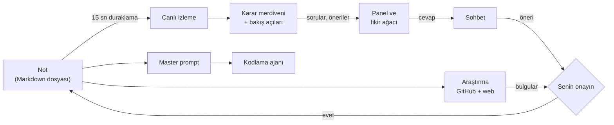

<p align="center"></p>

# Concept Trail — Tanıtım

[English](INTRODUCTION.md) · **Türkçe**

> **Kod yazmadan önce fikrini düşünmene yardım eden bir not defteri.**
> Sen yazarsın; asistan fikrin açık uçlarını sorar, cevaplarını seninle tartışır, bu fikri daha önce kimin yaptığını araştırır ve sonunda bir yapay zekâ kodlama ajanının hiç soru sormadan uygulayabileceği eksiksiz bir talimat hazırlar. Notuna senin onayın olmadan tek kelime yazmaz.

---

## Çözdüğü sorun

Bir yazılım fikri aklımıza geldiğinde henüz bulanıktır. Ama heyecanla hemen kod yazmaya başlarız. Sonra yolda karşımıza başta hiç düşünmediğimiz sorular çıkar ve bazıları o kadar temeldir ki projeyi baştan kurmak gerekir.

**Tanıdık bir örnek:** "Ev bitkilerimi sulamayı unutuyorum, bana hatırlatan bir uygulama yapayım" diye başlarsın. Tek kişilik bir yapılacaklar listesi yazarsın. İki hafta sonra eşin de kullanmak ister. Artık bitkilerin bir *sorumlusu* olmalı, hatırlatma doğru kişiye gitmeli, iki telefon aynı veriyi görmeli. Veri modelin, bildirim mantığın ve depolaman bunu hiç bilmiyordu; yarısını yeniden yazarsın.

Oysa bu soru baştan sorulabilirdi: *"Bunu sadece sen mi kullanacaksın, yoksa evdeki herkes mi?"* Concept Trail o soruları doğru sırayla, doğru zamanda sorar.

| Sorun | Genelde ne olur | Concept Trail'de |
|---|---|---|
| **Bulanık fikirle başlamak** | Temel bir karar (kim kullanacak, nerede çalışacak) sonradan değişir, sistem baştan kurulur | **Karar merdiveni** önce kapsamı, sonra mimariyi, sonra parçaları, en son detayları sorar |
| **Neyi bilmediğini bilmemek** | Sorulmayan soru, sonradan hata olarak döner | Her turda **Mimar, Ürün, Güvenlik ve işletim, Geliştirici** gözü notu eleştirir; uç durumlar ve hata senaryoları kendi basamaklarında sorulur |
| **Tekerleği yeniden icat etmek** | Haftalar sonra aynı şeyi yapan olgun bir proje bulunur | **Araştırma** GitHub'da ve web'de benzerleri bulur, en yakınlarını karşılaştırır, seni onlardan ayıracak noktaları çıkarır |
| **Kodlama ajanına eksik talimat vermek** | Claude Code ya da Codex boşlukları sessizce tahminle doldurur | **Master prompt** her açık kararı verir ve **Varsayımlar** bölümünde gerekçesiyle listeler |
| **Asistanın notu ele geçirmesi** | Yapay zekâ metni kendi sesiyle yeniden yazar, fikir senin olmaktan çıkar | Hiçbir şey **onaysız** nota girmez; her ekleme bir öneri kartıdır |
| **Soruların ve bağlamın kaybolması** | Sohbet geçmişinde neyin cevaplandığı kaybolur | **Fikir ağacı**: her soru bir yıldız; cevap bekleyenler parlar, her dal kendi konuşmasını bilir |
| **Kısıtlanmışlık hissi** | Sabit bir soru sınırı, tam açılmışken yazarı durdurur | **Kaç soru sorulacağına model karar verir**: senin temponu görür, sen cevapladıkça devam eder |
| **Maliyet ve gizlilik** | Notlar bilinmeyen sunuculara gider, faturalar kabarır | Uygulama yalnız bilgisayarında çalışır; gizli notlar hiç dışarı çıkmaz; yerel model desteği; günlük harcama sınırı |

---

## Bir oturum, baştan sona

Aynı örnek üzerinden: bitki sulama hatırlatıcısı.

### 1. Yazarsın, asistan dinler

Yeni bir not açıp aklındakini yazarsın:

```markdown
# Bitki hatırlatıcı
Bitkilerimi sulamayı sürekli unutuyorum. Bana zamanı gelince
haber veren basit bir şey istiyorum.
```

Yazmaya **15 saniye ara verdiğinde** asistan notu sessizce okur. Araya girmez, pencere açmaz: bulduklarını sağdaki panele bırakır.

### 2. Sorular genişten dara: karar merdiveni

Bir yazılım fikri dört basamaktan geçer. Asistan yalnızca bulunduğun basamağın açık kararlarını sorar. Platform belli değilken veritabanı sormaz.

| Basamak | Kararlar | Bu örnekte |
|---|---|---|
| **Kapsam** | amaç · kullanıcı · platform · çalışma ortamı | *amaç* notta var, kaydedilir: "bitkileri sulamayı hatırlatmak". Sorulanlar: "Sadece sen mi kullanacaksın, evdeki herkes mi?" · "Telefon uygulaması mı, web mi?" · "İnternet yokken de çalışmalı mı?" |
| **Mimari** | ana parçalar · veri · iletişim · dış bağımlılıklar | "Sulama zamanlarını nerede tutacaksın, telefonda mı bir sunucuda mı?" |
| **Bileşenler** | sorumluluklar · arayüzler · hata durumu | "Bildirim gönderilemezse ne olacak?" |
| **Detay** | teknoloji · uç durumlar · doğrulama · dağıtım | "Tatile gidince hatırlatmalar ne olacak?" |

Notta zaten yazan bir kararı tekrar sormaz. Senin kelimelerinle kaydeder ve sonraki sorular onun üstüne kurulur. On beş kararın hepsi verilince not **ürün evresine** geçer.

**Kaç soru sorulacağına model karar verir.** Notunda konuşulacak çok şey varsa ve sen cevap verdikçe sormaya devam eder. Cevapsız sorular birikmişse yalnızca gerçekten önemli olanı sorar. Sabit bir "en fazla üç soru" sınırı yoktur; kod yalnızca bozulmuş bir modelin durmadan soru üretmesine karşı bir sigorta tutar.

### 3. Cevaplarsın, tartışırsınız, sen onaylarsın

Soruya tek satırla cevap verebilir ya da onun için bir sohbet açabilirsin:

> **Asistan:** Sadece sen mi kullanacaksın, evdeki herkes mi?
> **Sen:** Eşim de kullanacak, bitkilerin yarısı onun.
> **Asistan:** Anladım — şunu notuna eklemeyi öneriyorum:
> *"Uygulamayı evdeki iki kişi kullanacak; her bitkinin bir sorumlusu olacak."*
> **[Onayla]** **[Reddet]**

Onaylarsan cümle notuna eklenir. Reddedersen hiçbir şey olmaz, sohbet sürer. Cevabın belirsizse asistan netleştirmek için sormaya devam eder. Ne zaman yeteceğine yine kendisi karar verir; aynı şeyi başka kelimelerle tekrar sormaz.

### 4. Farklı gözlerle öneriler

Her turda sırayla bir bakış açısı notu eleştirir. Öneri, notta yazan **iki şeyin birlikte doğurduğu**, senin henüz yazmadığın bir şey olmalıdır; genel tavsiye sayılmaz:

> **Ürün gözü önerisi:** Bitkilerin sorumlusu olacağı için hatırlatma yalnız o kişiye gitmeli, o kişi erteleyince diğerine geçmeli.
> *Dayanağı: "evdeki iki kişi" + "zamanı gelince haber veren"*

"Kullanıcı dostu olmalı" gibi her fikre uyan cümleler elenir.

### 5. Rotayı sen çizersin

Sorular fikri istemediğin yere götürüyorsa **Rotayı düzelt** ile yön verirsin:

> **Sen:** Aslında sadece balkondaki beş saksı için. Sensör falan yok, telefon bildirimi yeter.

Asistan bunu projenin amacı ve verilmiş kararlarla karşılaştırır ve ne değişeceğini listeler: *platform* "telefon uygulaması" olarak güncellenir, *dış bağımlılıklar* yeniden sorulur, "Sensör verisini nasıl okuyacaksın?" sorusu kapanır. İstemediğin kalemin işaretini kaldırırsın; hiçbiri sen onaylamadan olmaz.

### 6. Bu fikir yapılmış mı?

**Araştırma** fikrin kısa bir özetinden yola çıkar. GitHub'da ve web'de birden çok yoldan arar (konu etiketleri, anahtar kelimeler, "alternatives", "Show HN"…) ve her sonucu kaç bağımsız yolun bulduğuna göre sıralar. En yakın projeleri yakından inceler: ne kadar etkinler, lisansları ne, kullanıcıları issue'larda neden şikâyet ediyor.

Sonuç bir karşılaştırmadır (aşağıdaki yalnızca bir gösterimdir):

| Fikrinin parçası | Benzer proje A | Benzer proje B |
|---|---|---|
| Zamanı gelince hatırlatma | var | var |
| Bitki başına sorumlu kişi | yok | kısmen |
| İnternetsiz çalışma | var | yok |

> **Seni ayıracak nokta:** Hatırlatmanın sorumlu kişiye gitmesi ve erteleyince diğerine geçmesi; incelenen projelerde bu yok.
> **Onlardan alınacak ders:** B'nin kullanıcıları bildirimlerin gecikmesinden şikâyet ediyor; bildirim zamanlamasını telefonun kendisine bırak.

Seçtiğin bulgular nota yine yalnız onayınla girer. Araştırma hiçbir zaman "fikrin özgün" demez; aramada görünmemek yokluk kanıtı değildir.

### 7. Fikir ağacı: düşüncenin haritası

Not ortada parlayan bir yıldızdır; soruları, önerileri ve sohbetleri ondan ışın ışın dağılır.

- **Cevap bekleyen sorular parlar** ve iplerinden ışık akar; çözülenler sakin bir ışıkla kalır.
- Bir yıldıza tıklayınca kartı ondan büyüyerek açılır; nottan o yıldıza giden yol aydınlanır, gökyüzünün geri kalanı kararır.
- İpler gerçek ip gibi davranır: yıldızı sürükleyince bağlı olanları çeker. Gökyüzünü kaydırınca asılı olanlar kalkışta geride kalır, durunca ileri salınır.
- **N** tuşu cevap bekleyen sıradaki soruya uçar.
- Gökyüzü temayla değişir: açık bir gece, ateş böcekli bir orman gecesi, kıvılcımlı bir gün batımı, eski bir yıldız haritası gibi sepya bir gece, kutup ışıklı bir buzul gecesi, yüksek karşıtlık için sade bir siyah.

### 8. Master prompt: fikirden uygulamaya

Tek tuş (**Ctrl Shift M**). Not, verilen kararlar, cevapladığın sorular, onayladığın ve reddettiğin öneriler ve araştırma birleşir. Sonuç, bir kodlama ajanının (Claude Code, Codex…) uygulamayı **hiç soru sormadan** yapabileceği bir talimattır: ürün özeti, kapsam, teknoloji yığını (sürümleriyle), mimari, veri modeli, API sözleşmeleri, ekranlar, hata ve uç durumlar, güvenlik, klasör yapısı, kilometre taşları, testler ve kabul ölçütleri, kurulum.

Notun açık bıraktığı her şeyi model kendisi karara bağlar ve gerekçesiyle yazar:

```markdown
## Varsayımlar
- Veriler telefonda yerel bir veritabanında tutulur; not internetsiz
  çalışmayı istiyor ve iki kişilik bir ev için sunucu gerekmiyor.
- Eşitleme, aynı ağa bağlanınca iki telefon arasında yapılır.
```

Pencere bu varsayımları en üstte gösterir; katılmadığın bir şey varsa notunu düzeltip yeniden üretirsin. Talimat beş dilden birinde hazırlanabilir; kopyalanır, yeni not olarak kaydedilir ya da .md olarak indirilir.

---

## Nasıl çalışır: kısa mimari



- **Notlar düz Markdown dosyalarıdır** (`Belgeler\Concept Trail`). Uygulamayı silsen de notların kalır; başka bir düzenleyicide de açılır.
- **Sunucu yalnızca bilgisayarında** (`127.0.0.1`) çalışır; arayüz bir tarayıcı penceresidir ya da masaüstü kabuğunun içindedir.
- **Model bağımsızdır:** OpenAI uyumlu her uç çalışır: OpenRouter (ör. ucuz ve hızlı `openai/gpt-4o-mini`), başka bir bulut API'si ya da internetsiz çalışan yerel bir llama.cpp sunucusu. İşler rollere ayrılır (analiz, sohbet, özet, araştırma yargıları, master prompt); her rol bir sağlayıcı zincirine bağlanır, ilki kapalıysa sıradaki devreye girer.
- **Ölçerek seçildi:** aynı beş senaryoda GPT-4o-mini notta yazan 14 kararın 14'ünü buldu, hiçbirini uydurmadı; tur başına yaklaşık 2 saniye ve $0,0002.

## Tasarım ilkeleri

1. **Not senindir.** Asistan önerir, sen karar verirsin. Onaysız tek kelime yazılmaz.
2. **Doğru soru, doğru zamanda.** Genişten dara; sırası gelmemiş ayrıntı sorulmaz, zaten verilmiş karar tekrar sorulmaz.
3. **Merakı kısma.** Soru sayısını model senin tempona göre ayarlar; sabit bir sınır yoktur.
4. **Somut ol.** Genel tavsiye öneri sayılmaz; her öneri notunda yazan şeylere dayanır.
5. **Dürüst ol.** Araştırma "özgün" demez; model bir kararı kendisi verdiyse bunu varsayım olarak açıkça yazar.
6. **Gizli kalan gizli kalır.** Başına `private: true` yazılan bir not uzak modellere hiç gönderilmez, araştırılmaz. API anahtarları notların yanında değil, sistemin ayar klasöründe durur.

## Kimler için

- Aklındaki fikri koda dökmeden önce netleştirmek isteyen **bağımsız geliştiriciler**
- Proje ödevini ya da bitirme projesini planlayan **öğrenciler**
- Bir özelliğin kapsamını ekibe götürmeden önce düşünen **ürün insanları**
- Birkaç saatte fikirden prototipe gitmek zorunda olan **hackathon takımları**
- İşi bir **yapay zekâ kodlama ajanına** verip, onun doğru şeyi yapmasını isteyen herkes

## Sık sorulanlar

**Notlarım buluta gidiyor mu?** Uygulama bilgisayarında çalışır. Asistanın düşünmesi için notun, ayarlarda seçtiğin modele gönderilir. OpenRouter gibi bir bulut modeli seçtiysen oraya, yerel bir model seçtiysen hiçbir yere. Başına `private: true` yazdığın notlar uzak modellere hiç gitmez.

**Ücretli mi?** Uygulamanın kendisi ücretsizdir. Bulut modeli kullanırsan sağlayıcının ücretini ödersin; GPT-4o-mini ile bir tur yaklaşık $0,0002'dir ve günlük harcama sınırı (varsayılan $0,50) ayarlardan değiştirilir. Yerel modelle ücret yoktur.

**Hangi dilleri destekliyor?** Arayüz ve asistan Türkçe, English, Deutsch, Español ve Français konuşur; asistanın dili arayüzden ayrı seçilebilir. Master prompt da bu beş dilden birinde hazırlanır.

**Yazılım dışı fikirler için de olur mu?** Olur. Notun başına `tur: fikir` yazarsan asistan karar merdiveni yerine merak soruları sorar: fikri derinleştiren, alternatif düşündüren, sonucunu hayal ettiren sorular.

```markdown
---
tur: fikir
---
# Mahalle kitap takası
```

## Kurulum

**Windows** (PowerShell'e yapıştır, yönetici izni gerekmez):

```powershell
irm https://raw.githubusercontent.com/Haci-brt/concept-trail/main/install.ps1 | iex
```

**macOS / Linux:**

```bash
curl -fsSL https://raw.githubusercontent.com/Haci-brt/concept-trail/main/install.sh | bash
```

Komut uygulamayı indirir, kendi Python ortamını kurar, masaüstüne ve Başlat menüsüne uygulama simgesiyle bir kısayol koyar ve uygulamayı açar. İlk açılışta kısa bir sihirbaz asistanı bir modele bağlar: OpenRouter anahtarı, bilgisayarında çalışan bir model (Ollama, LM Studio, llama.cpp kendiliğinden bulunur) ya da başka bir servis. Güncellemek için aynı komutu yeniden çalıştırırsın; notların ve ortam korunur. Ayrıntılar için [README](../README.tr.md).
